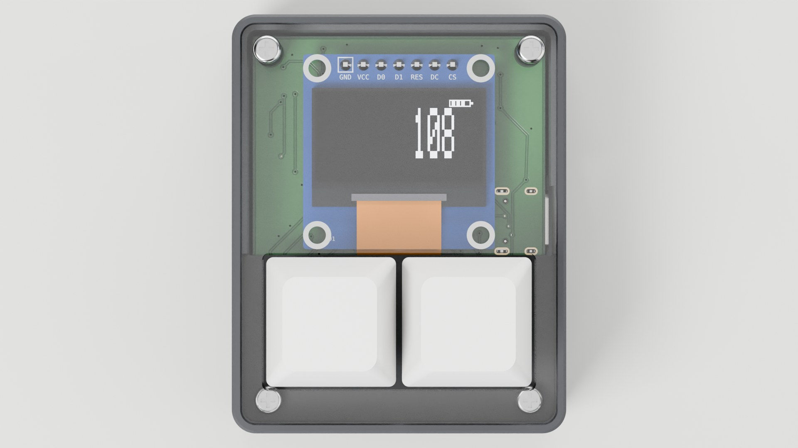
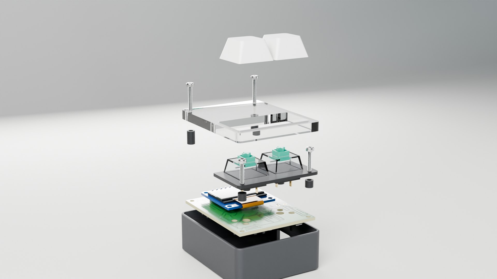
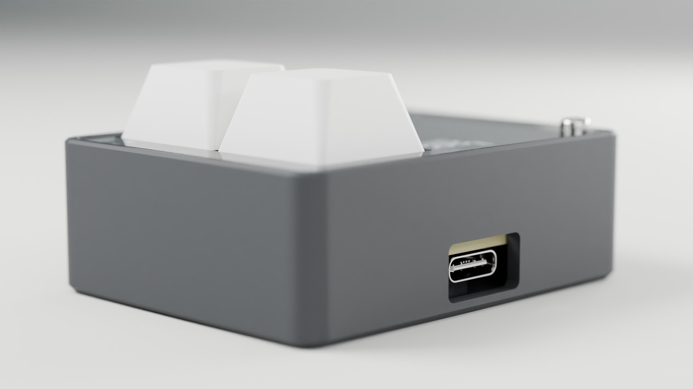
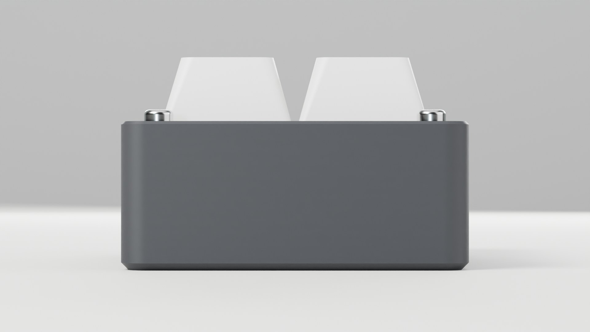
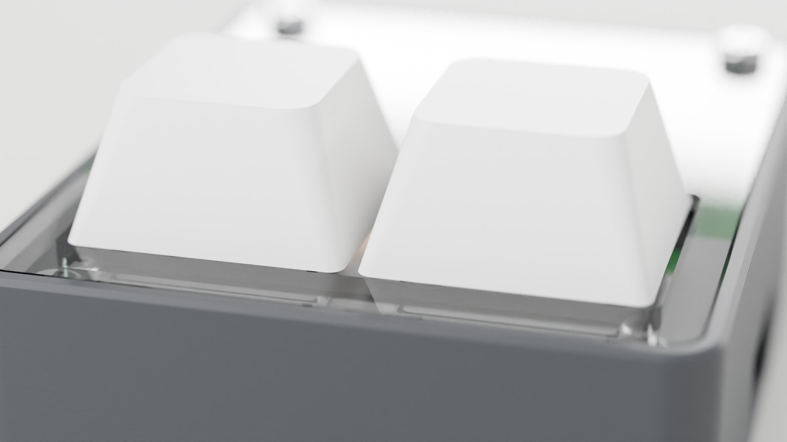

# Q5B — bezel tray, one-piece acrylic faceplate on four screws, hidden switch plate

Q5B is the third enclosure for the **ordered, locked Q5 board**. The board, BOM and every Q5/Q5A file are unchanged. It follows the owner's review of Q5A (24 Nov 2026):

- **Keys are Kailh Box Jade** (3-pin, plate mount) with **standard MX keycaps**, not the HanElectricity switch and printed tiles. Q5A's lid held the switches by a 0.20 mm overlap on a raised rim that Box switches do not have.
- **Keys sat too proud** and looked fragile.
- **Case changes:** a thin printed bezel should frame the acrylic, the walls should be thicker, and the bottom edge chamfered.
- **Fasteners** should be easy to buy, with **captive nuts under the case**; spacers may be printed.
- **The top must be one solid acrylic piece.** A two-part bottom is fine.
- **All four screws go through the acrylic top** (25 Nov 2026), so there are no hidden screws.

**Body: 47.0 × 64.0 × 20.0 mm**; standard OEM-style keycap tops are about 29.2 mm above the table. The case is 5 mm longer than the first Q5B so that the lower screws can sit below the keys. Q5A was 45.4 × 57.4 × 16.8 mm.


| | |
|---|---|
|  |  |
|  |  |
|  |  |

## Design

| Decision | Why |
|---|---|
| **One 4.5 mm clear cast-acrylic faceplate** (3/16 in is fine) over the whole top, with a single 38.45 × 19.4 mm well round both keycaps. Underside at PCB top + 6.7. | **Shape:** one solid, thick piece with no seams. **Clearance:** it covers the display with a 1.0 mm air gap over the OLED maximum. **Keycap fit:** standard keycaps drop into the well with 0.6 mm all round, and rest with their skirts 0.2 mm below its top face, so only the caps stand up (9.2 mm). |
| **Hidden 1.5 mm black switch plate**, part of the bottom assembly, at the standard MX plate height (top = PCB top + 5.0). It has 14.0 mm cut-outs, rests on the two tray posts below the keys, and is clamped there by the lower faceplate screws. | **Retention:** Box switches clip into a 1.5 mm plate the standard way, so they cannot pull out with a keycap; this replaces Q5A's rim capture. **Clearance:** the plate stops 0.5 mm short of the OLED module, which occupies that height. **Material:** black acrylic (laser) or printed PETG (`plate-printable-Q5B.stl`) both work. |
| **Faceplate fixing: four M2 × 18 screws, all through the acrylic.** The upper pair use the board's upper holes on 6.7 mm spacers. The lower pair sit 29.7 mm below the board centre, just outside the board edge, on tray posts; a 1.7 mm spacer sits between the plate and the faceplate. | **Why not the board's lower holes:** they sit at the keycaps' bottom corners, so a hole there leaves only 0.3 mm of acrylic to the key well. Below the keys there is 5.0 mm of acrylic between each hole and the well, and the heads are 4.8 mm from the keycaps. |
| **Printed locating pegs in the board's lower holes**, 3.5 mm long with 1.9 mm pins into the board and the plate | **Hold the board's key end down** under the clamped plate and locate the plate, so the lower board holes need no screws. |
| **Bezel tray:** 2.0 mm walls (5 perimeters) up to the PCB, then a 1.2 mm bezel round the faceplate with 0.25 mm clearance; the top is flush with the faceplate. Printed ledges sit 0.1 mm under the faceplate (display half) and under the plate (key half). | **Protection:** the acrylic edge is covered. **Stiffness:** the thicker walls are stiffer for drops. **Heights:** the spacers set them, not the print. |
| **1.0 mm 45° bottom chamfer**; 0.4 mm top chamfer | **Bottom:** hides elephant's foot. **Top:** breaks the bezel edge. |
| **M2 pan-head machine screws into hex nuts captive in pockets under the tray**: 4 × M2 × 18 | **No threads in plastic.** **Pocket size:** the pockets are 4.15 mm across flats, in a widened boss base. The parts under the board start 5 mm up, so the base has room to grow. |
| **Printed spacers**: 2 × 6.7 mm (upper), 2 × 1.7 mm (lower, plate to faceplate); 2 × 3.5 mm pegs | Their length sets the faceplate height. **Print solid and check the length with calipers** (±0.1 mm). The lower posts are part of the tray and set the plate height. |

## Parts

| Item | Qty | Specification |
|---|---:|---|
| Tray | 1 | `tray-Q5B.stl`, PETG, 0.2 mm layers, 5 perimeters, floor down, no supports |
| Faceplate | 1 | Clear **cast** acrylic **4.5 mm** (3/16 in; 4.3–5.0 accepted), `faceplate-acrylic-Q5B.svg` / `.dxf` |
| Switch plate | 1 | **Made, not bought** (switches do not come with one). Print `plate-printable-Q5B.stl` in PETG, solid, flat; or laser-cut 1.5 mm black acrylic (`plate-acrylic-Q5B.svg` / `.dxf`). 3/16 in sheet is too thick for switch clips. |
| Spacers | 2 + 2 | `spacer-6.7-Q5B.stl`, `spacer-1.7-Q5B.stl`, OD 4.0 / ID 2.3 |
| Locating pegs | 2 | `peg-3.5-Q5B.stl` (print pins up, solid) |
| Screws | 4 | **M2 × 18** pan-head machine screws (ISO 7045 / DIN 7985, head ≤ 4.0 × 1.6 mm) |
| Nuts | 4 | **M2 hex nuts** (ISO 4032, 4.0 mm AF × 1.6 mm) |
| Switches / keycaps | 2 / 2 | Kailh Box Jade (3-pin) in the board's MX hot-swap sockets; standard 1u MX keycaps |

**Buying the hardware:**
- **Board holes:** these are 2.2 mm, so the fasteners must be **M2**. M3 does not fit, and #2-56 is too tight in the plated holes.
- **Where to buy:** hardware stores reliably stock M3, but M2 is hit or miss. An M2 pan-head assortment with nuts is the dependable source.

## DFM

- **Switch fit:**
  - **Laser-cut plate:** cut `laser-coupon-Q5B.svg` from the 1.5 mm sheet first. A Box Jade should click into the 14.0 mm hole and not rock.
  - **Printed plate:** check the same fit on a print.
- **Faceplate thickness:** 4.3–5.0 mm is accepted, so 3/16 in (4.76 mm) sheet works. The datum is its underside, so thickness only moves the top face. The screws keep 1.18–1.6 mm of thread in the nut across that range (1.42 mm at 3/16 in).
- **Faceplate edges and webs:**
  - side rails beside the well: 2.83 mm;
  - strip below the well: 9.55 mm;
  - lower screw hole to well: 5.0 mm;
  - screw hole to edge: 2.15 mm minimum.
- **Tightening:** stop as soon as the heads seat; acrylic cracks at over-clamped holes.

## Assembly

1. Press the four nuts into the hex pockets from underneath. A dab of tape holds them if the fit is loose.
2. Insert the LIR2032 with USB connected (Q5 USB-first rule), then lower the board into the tray.
3. Push a peg into each of the board's two lower holes.
4. Clip both Box Jades into the plate. Lower the plate and switches so the switch pins enter the hot-swap sockets, the peg pins enter the plate, and the plate rests on the two tray posts.
5. Put the 6.7 mm spacers on the upper board holes and the 1.7 mm spacers on the plate over the posts. Lay the faceplate in its pocket and drive the four M2 × 18 screws.
6. Press on the keycaps through the well.

## What the generator checks

`scripts/build_q5b_enclosure.py` reads the native board through the Q5 builder and reuses the Q5A board envelopes. It writes `fit-report.json` and `build-manifest.json`. The final build found:
- **Parts:** valid single solids and manifold, bed-aligned STLs.
- **Static clearance:** zero static intersections among the tray, faceplate, plate, switches, spacers, screws, nuts, the board and every component envelope, and the USB plug reservation.
- **Keycaps:** clear at rest and fully pressed (4.0 mm travel, 0.3 mm wobble allowance) against the tray, the thickest accepted faceplate, the plate and all screws.
- **Assembly paths:** zero collisions on straight vertical paths (366 poses, 94,428 sampled tests).

| Minimum modelled distance (mm) | |
|---|---|
| OLED maximum to faceplate underside | 1.0 |
| Keycap to faceplate well, plan | 0.6 |
| Lower screw hole to key well (acrylic web) | 5.0 |
| Keycap to nearest screw head, plan | 4.85 |
| Pressed keycap skirt above the plate | 2.0 |
| Lower tray post to board edge | 0.5 |
| Plate edge to OLED module footprint | 0.5 |

## Not established (first-article checks)

Nothing here is a measurement. Before calling Q5B done, check:
- **Switches and keycaps:**
  - Box Jade fit in the plate;
  - real keycap size and skirt height. The check assumes an 18.2 mm OEM-R3-like 1u cap with its skirt at PCB top + 11.0. The board's 19.05 mm switch pitch leaves about 0.85 mm between standard caps, as on any keyboard;
- **Fasteners:**
  - nut-pocket fit on a real print;
  - spacer lengths and peg-pin fit in the 2.2 mm board holes on a real print;
- **Case and acrylic:**
  - acrylic crazing at the screw holes;
  - OLED readability through 4.5 mm;
  - USB cable fit;
  - drop behaviour.

## Renders

`scripts/render_q5b/` adapts the Q5A pipeline:
- **Board:** the native board textures and KiCad STEP models.
- **Enclosure:** the checked enclosure parts.
- **Display:** firmware OLED frames.
- **Appearance models:** the Box Jade, screws, nuts and keycaps are appearance models.
- **Substitutions:** Blender's bundled `studio.exr` stands in for the Poly Haven HDRIs, and DejaVu for the decal fonts, because those downloads were blocked where these were made.

```sh
python3 -B scripts/build_q5b_enclosure.py --kicad-python /usr/bin/python3
python3 -B scripts/render_q5b/build_render_assets.py --kicad-python /usr/bin/python3   # textures/OLED/decals as for Q5A
python3 -B scripts/render_q5b/render_stills.py -- --shots hero,top,lowangle,exploded2,keys,under,side --samples 128 --out build/render-q5b/stills
```
