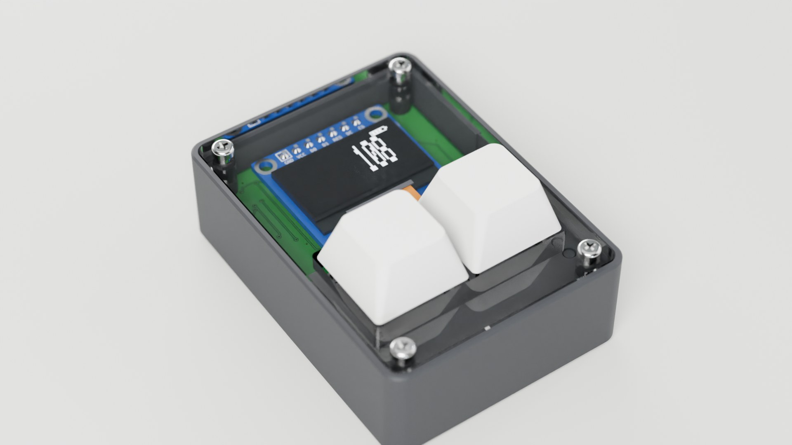
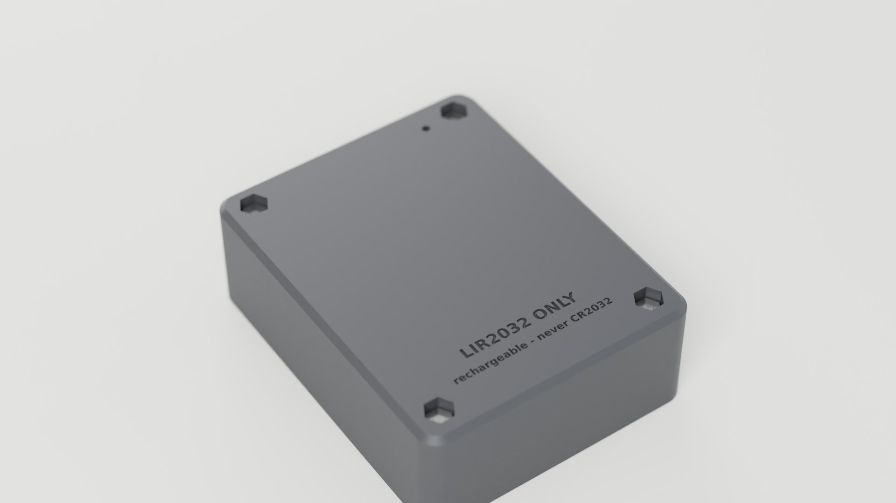

# Q5B — bezel tray, acrylic display window, acrylic switch plate

Q5B is the third enclosure for the **ordered, locked Q5 board**. The board, BOM and every Q5/Q5A file are unchanged. It follows the owner's review of Q5A (24 Nov 2026):

- **Keys are Kailh Box Jade** (3-pin, plate mount) with **standard MX keycaps**, not the HanElectricity switch and printed tiles. Q5A's lid held the switches by a 0.20 mm overlap on a raised rim that Box switches do not have.
- **Keys sat too proud** and looked fragile.
- **Case changes:** a thin printed bezel should frame the laser part, the walls should be thicker, and the bottom edge chamfered.
- **Fasteners** should be easy to buy, with **captive nuts under the case**; spacers may be printed.

**Body: 47.0 × 59.0 × 19.3 mm**; standard OEM-style keycap tops are about 29.2 mm above the table. Q5A was 45.4 × 57.4 × 16.8 mm.



| | |
|---|---|
|  |  |
|  |  |
|  |  |

## What changed from Q5A, and why

| Change | Why |
|---|---|
| **Two laser parts instead of one lid.** A 1.5 mm **switch plate** sits at the standard MX plate height (top = PCB top + 5.0) with 14.0 mm cut-outs under the keys. A 4.5 mm clear **display window** sits over the OLED (underside = PCB top + 6.0). | **The plate retains the switches the standard way.** Every MX/Box switch clips into a 1.5 mm plate at 14.0 mm, so retention no longer depends on a fraction of a millimetre of rim. This removes the Q5A rim-capture risk entirely. **The plate stops short of the display** because the OLED module occupies that height (PCB top + 2.3 to + 5.7). **The window keeps Q5A's 0.3 mm air gap over the OLED maximum.** |
| **The window stops just above the keys (edge 0.75 mm from the keycaps), and its thickness forms the top wall of a key well.** | **Lowering the keys:** standard caps rest with their skirts 0.5 mm above the bezel, so no switch housing shows and only the keycap stands up (9.9 mm). **Screw clearance:** a window that wrapped round the keys would have had to pass the lower screw heads 0.2 mm from the keycaps. Here those heads sit low on the plate, 0.4 mm under a fully pressed skirt. |
| **Bezel tray**: 2.0 mm walls (5 perimeters) up to the PCB, then a 1.2 mm bezel round both laser parts with 0.25 mm clearance; top flush with the window. Printed ledges sit 0.1 mm under each laser part, so the spacers, not the print, set the heights. | **Protection:** the acrylic edges are covered and cannot be knocked or snagged. **Strength:** the thicker walls are stiffer and stand up better to drops. |
| **1.0 mm 45° bottom chamfer**; 0.4 mm top chamfer | **Bottom:** hides elephant's foot and makes the box look lighter. **Top:** breaks the bezel edge. |
| **M2 pan-head machine screws into hex nuts captive in pockets under the tray**: 2 × M2 × 18 through the window, 2 × M2 × 12 through the plate | **No threads in plastic,** so the case survives as many cell changes as needed. **Pocket size:** the hex pockets (4.15 mm across flats) sit in a widened boss base. The parts under the board start 5 mm up, so the base has room to grow. |
| **Printed spacers**, 2 × 6.0 mm and 2 × 3.5 mm (`spacer-*.stl`) | The spacer lengths set the window and plate heights. **Print solid and check the length with calipers** (±0.1 mm). |

## Parts

| Item | Qty | Specification |
|---|---:|---|
| Tray | 1 | `tray-Q5B.stl`, PETG, 0.2 mm layers, 5 perimeters, floor down, no supports |
| Display window | 1 | Clear **cast** acrylic **4.5 mm** (3/16 in, 4.3–5.0 accepted), `window-acrylic-Q5B.svg` / `.dxf` |
| Switch plate | 1 | Cast acrylic **1.5 mm** (clear, or black to hide the board), `plate-acrylic-Q5B.svg` / `.dxf` |
| Spacers | 2 + 2 | `spacer-6.0-Q5B.stl` (upper), `spacer-3.5-Q5B.stl` (lower), OD 4.0 / ID 2.3 |
| Screws | 2 + 2 | **M2 × 18** and **M2 × 12** pan-head machine screws (ISO 7045 / DIN 7985, head ≤ 4.0 × 1.6 mm) |
| Nuts | 4 | **M2 hex nuts** (ISO 4032, 4.0 mm AF × 1.6 mm) |
| Switches | 2 | Kailh Box Jade (3-pin), into the board's MX hot-swap sockets |
| Keycaps | 2 | Standard 1u MX keycaps |

**Buying the hardware:**
- **Board holes:** these are 2.2 mm, so the fasteners must be **M2**. M3 does not fit, and #2-56 is too tight in the plated holes.
- **Where to buy:** hardware stores reliably stock M3, but M2 is hit or miss. An M2 pan-head assortment with nuts is the dependable source.

## Laser-cut DFM

- **Cut a coupon first.** Cut `laser-coupon-Q5B.svg` from the **1.5 mm plate sheet** first. A Box Jade should click into the 14.0 mm hole and not rock. If it is loose, use the size that fits and adjust the plate file.
- **Use cast acrylic for both parts.** It edges better, and it is less prone to crazing at the screw holes.
- **Edges and webs:**
  - screw hole to part edge: 1.85 mm minimum;
  - web between the two switch cut-outs: 5.05 mm;
  - plate top edge to cut-out: 2.35 mm.
- **2D profiles only.** Inside corners are rounded (cut-outs R0.3, part corners R0.5 to R1.95).
- **The datum is the underside of each part.** Window thickness only moves its top face.
- **Thread engagement across the window range:** at 4.3 mm the upper screw has the full 1.6 mm of nut thread; at 5.0 mm it has 1.18 mm. No screw tip comes nearer than 1.1 mm to the table.
- **Tightening:** stop as soon as the heads seat; acrylic cracks at over-clamped holes.

## Assembly

1. Press the four nuts into the hex pockets from underneath. A dab of tape holds them if the fit is loose.
2. Insert the LIR2032 with USB connected (Q5 USB-first rule), then lower the board straight into the tray. The USB receptacle slides down the hidden wall relief.
3. Clip both Box Jades into the plate.
4. Put the 3.5 mm spacers on the two lower mounting holes. Lower the plate and switches so the switch pins enter the hot-swap sockets.
5. Drive the two M2 × 12 screws through the plate into the lower nuts.
6. Put the 6.0 mm spacers on the upper holes, then lay the window in its pocket.
7. Drive the two M2 × 18 screws through the window into the upper nuts.
8. Press on the keycaps.

To change the cell, remove the keycaps and the four screws, lift off the window, plate and switches, then lift out the board.

## What the generator checks

`scripts/build_q5b_enclosure.py` reads the native board through the Q5 builder and reuses the Q5A board envelopes. It writes `fit-report.json` and `build-manifest.json`. The final build found:
- **Parts:** valid single solids (tray, window, plate, spacers) and manifold, bed-aligned STLs.
- **Static clearance:** zero static intersections among the tray, both laser parts, switches, spacers, screws, nuts, the board and every component envelope, and the USB plug reservation.
- **Keycaps:** clear at rest and fully pressed (4.0 mm, with a 0.3 mm wobble allowance) against the tray, the thickest accepted window, the plate and all screws.
- **Assembly paths:** zero collisions on straight vertical paths (366 poses, 80,642 sampled tests): board, then plate with switches and lower spacers, then lower screws, then window with upper spacers, then upper screws, then keycaps.

| Minimum modelled distance (mm) | |
|---|---|
| OLED maximum to window underside | 0.30 |
| Keycap to window edge, plan | 0.75 |
| Keycap skirt at rest above the bezel/window top | 0.5 |
| Pressed skirt above the plate / above the lower screw heads | 2.0 / 0.4 |
| Keycap to lower screw head, plan | 0.22 |
| Plate edge to OLED module footprint | 0.50 |
| USB mouth to outer wall | 1.93 (the 13.4 × 7.2 opening admits the full USB-C overmold) |

## Not established (first-article checks)

Nothing here is a measurement. Before calling Q5B done, check:
- **Switches and keycaps:**
  - Box Jade fit in the 14.0 mm plate cut-out (laser coupon);
  - real keycap skirt height and size. The check assumes an OEM-R3-like 1u cap with its skirt at PCB top + 11.0 at rest, 18.2 mm wide. A lower skirt, or a cap wider than 18.5 mm, would bring it closer to the lower screw heads;
  - Box Jade top-housing envelope (modelled 15.6 → 13.0 mm, 6.6 mm above the plate);
- **Fasteners:**
  - nut-pocket fit on a real print;
  - spacer lengths on a real print;
- **Case and acrylic:**
  - acrylic crazing at the screw holes;
  - OLED readability through 4.5 mm of acrylic;
  - the 0.5 mm board clearance;
  - USB cable fit;
  - drop behaviour.

## Renders

`scripts/render_q5b/` adapts the Q5A pipeline:
- **Board:** the native board textures and KiCad STEP models.
- **Enclosure:** the checked enclosure parts.
- **Display:** firmware OLED frames.
- **Appearance models:** the Box Jade, M2 screws, nuts and keycaps are appearance models.
- **Substitutions:** studio lighting uses Blender's bundled `studio.exr` instead of the Poly Haven HDRIs, and the decal fonts are DejaVu, because those downloads were blocked where these were made.

Reproduce:

```sh
python3 -B scripts/build_q5b_enclosure.py --kicad-python /usr/bin/python3
python3 -B scripts/render_q5b/build_render_assets.py --kicad-python /usr/bin/python3   # then textures/OLED/decals as for Q5A
python3 -B scripts/render_q5b/render_stills.py -- --shots hero,keys,lowangle,exploded,side,top,under --samples 128
```
